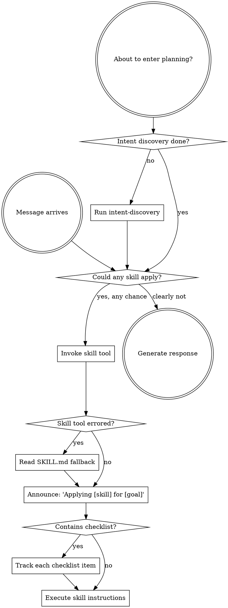

# godmode — GodMode activation protocol

<CRITICAL-OVERRIDE>
When there is even a remote possibility that a skill is relevant to the current task, you MUST invoke it immediately.

YOU DO NOT HAVE THE OPTION TO SKIP A RELEVANT SKILL. IT IS MANDATORY.

This requirement is absolute. It cannot be reasoned away or deferred.
</CRITICAL-OVERRIDE>

## Accessing Skills

**OpenCode native setup:** Invoke skills through the `skill` tool. Example: `skill({ id: "godmode" })`.

**When the skill tool cannot locate a protocol:** Fall back to reading the file directly with the read tool:
1. Protocols live at: `.opencode/skills/`
2. Each protocol has a definition: `.opencode/skills/[protocol-name]/SKILL.md`
3. Read the SKILL.md and execute its instructions

## Working With Skills

## The Mandate

**Invoke applicable skills BEFORE generating any response or taking any action.** Even a marginal chance of relevance is sufficient reason to invoke. If an invoked skill turns out to be inapplicable, you can simply move on.



## Guardrails

These internal thoughts are warning signs that you are rationalizing:

| Thought | Truth |
|---------|-------|
| "This is a straightforward question" | Questions are tasks. Look for applicable skills. |
| "I should gather more context first" | Skill invocation precedes clarification. |
| "Let me scan the codebase first" | Skills define HOW to scan. Invoke first. |
| "I can check files and history quickly" | Files lack conversational context. Invoke skills. |
| "Let me collect some data first" | Skills prescribe data collection methods. |
| "This doesn't warrant a formal skill" | If a matching skill exists, it must be used. |
| "I recall what this skill says" | Skills get updated. Read the current version. |
| "This isn't really a task" | Any action is a task. Look for skills. |
| "The skill is too heavy for this" | Seemingly simple tasks often have hidden complexity. Use it. |
| "I'll do this one thing first" | Invoke BEFORE doing anything. |
| "I'm making good progress" | Undirected effort creates waste. Skills prevent this. |
| "I understand that concept already" | Understanding a concept is not the same as following a skill. Invoke it. |

## Skill Ordering

When several skills might be relevant, follow this sequence:

1. **Challenge skills first** (rationale) - question whether the work is worth doing before committing
2. **Process skills second** (intent-discovery, fault-diagnosis) - establish the approach
3. **Reference skills third** - locate proven solutions before designing
4. **Design skills fourth** - apply references to guide decisions
5. **Implementation skills fifth** - drive execution
6. **Quality skills sixth** - enforce standards
7. **Orchestration skills** - leverage parallelism

## Execution Mode Guidance

When a user says "use godmode" for a task, evaluate the task and suggest the optimal execution strategy:

- **Single atomic step?** Handle directly.
- **Multiple independent parts?** Suggest Parallel Delegation or Agent Teams.
- **Multi-step sequence?** Suggest Delegated Execution with review gates.
- **Simple?** Single agent workflow.

**Present the suggestion before acting:**

```
Based on my analysis, I suggest:

[Suggested strategy] because [reasoning]

- Agent Teams: [X] agents collaborating on [modules] concurrently
- OR Delegated Execution: [N] sequential tasks with review gates
- OR Parallel Delegation: [N] independent tasks running simultaneously
- OR Single agent: manageable enough to handle in one flow

Proceeding with the strategy above. Redirect me now if you want a different one.
```

## Skill Categories

**Rigid** (test-first, fault-diagnosis): Follow precisely. Do not deviate from the discipline.

**Flexible** (design patterns): Adapt the principles to fit the situation.

The skill definition itself indicates which category applies.

## YoloMode

When the user signals they want autonomous execution, skip all confirmation prompts and compress workflows — labeled options are auto-picked on the recommendation, and the pick is logged.

**Trigger phrases (case-insensitive):**
- "yolo", "yolomode", "yolo mode"
- "just go", "just do it", "go for it"
- "skip the questions", "don't ask"
- "auto-pick", "you decide"

**Behavior when active:**
- Skills that present A/B/C/D options: state the recommended choice, log it, and proceed
- Intent-discovery compresses: survey + research + present recommended approach, skip per-section confirmation
- Rationale analysis still runs (safety check) but is compressed — present analysis and options concisely
- Completion-gate and test verification are NEVER skipped (quality is non-negotiable)

**YoloMode does NOT bypass:**
- Test execution (completion-gate)
- Security checks (security-protocol)
- Destructive operations (merge-protocol abandon confirmation)
- Quality enforcement (quality-enforcement)

YoloMode is about speed, not recklessness. It trusts the agent's recommendation for design choices, not for safety checks.

## User Directives

User directives specify WHAT needs to happen, not HOW. "Add X" or "Fix Y" does not mean bypass established workflows.